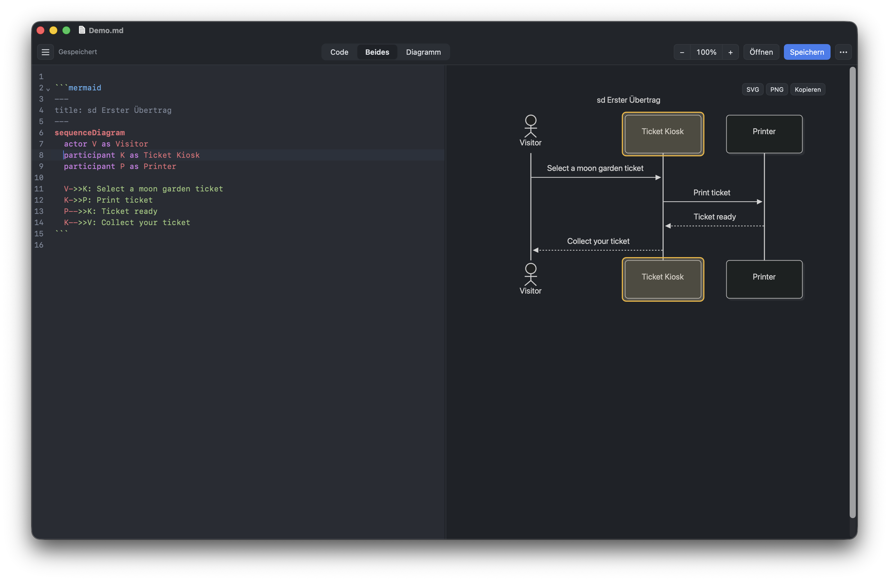

# Mermaid Editor

A lightweight Mermaid editor for Markdown and Mermaid files. Open a `.md` or `.mmd` file with your code on the left and a live diagram preview on the right.

- **See what you’re editing.** The preview highlights the part of the diagram you’re working on and scrolls to it.
- **Find the code with a click.** Click something in the diagram to jump straight to the line that defines it.
- **Export to PDF.** Choose **Export as PDF** to save your document. On Android, choose **Save as PDF** in the print dialog.

I built it for fun to make writing Mermaid diagrams easier. The app is available in English and German. Maybe it’ll come in handy or spark an idea!

## Screenshots

## Build it yourself

Clone this repository and run the commands from its root.

- **Web preview:** Run `npm ci && npm run build`, then `npm run dev -- --no-open --stay`. Open the local address printed in your terminal.
- **macOS:** Install Node.js and the Xcode Command Line Tools, then run `npm ci && npm run app`. Open `Mermaid Editor.app` when the build finishes.
- **Android:** With JDK 17, Android SDK Platform 34, and Build Tools 34.0.0 installed, run `npm ci && npm run android`. The APK is at `android/build/Mermaid-Editor.apk`. It runs on Android 8 or later with an up-to-date Android System WebView.

You can also run the [macOS build](https://github.com/rilvert/mermaid-editor-public/actions/workflows/macos-app.yml) manually in GitHub Actions on a fork.

### Android privacy

The Android app renders documents on your device and has no internet permission, telemetry, ads, or accounts. Drafts, settings, and file access grants stay in app storage and are excluded from Android backups and device transfers. Use **Clear storage** in the Android app settings to remove them.

When you open or save a file, Android uses the file provider you choose. External links open in your browser, PDF export uses Android’s print system, and copied diagrams are marked as sensitive in the clipboard.
