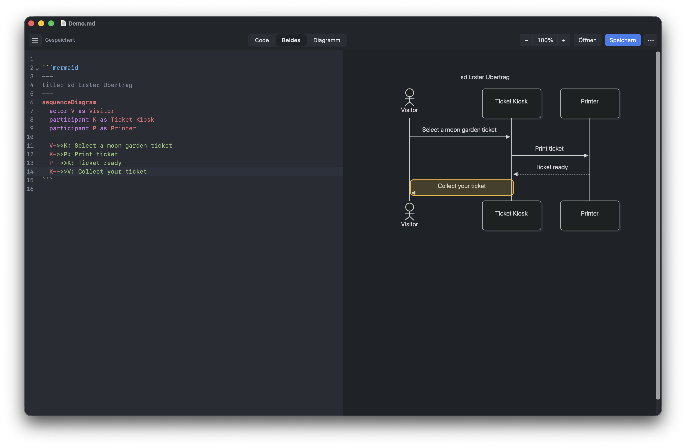

# Mermaid Editor

A lightweight Mermaid editor for Markdown and Mermaid files. Open a `.md` or `.mmd` file with your code on the left and a live diagram preview on the right.

- **See what you’re editing.** The preview highlights the part of the diagram you’re working on and scrolls to it.
- **Find the code with a click.** Click something in the diagram to jump straight to the line that defines it.
- **Export to PDF.** Choose **Export as PDF** to save your document. On Android, choose **Save as PDF** in the print dialog.

I built it for fun to make writing Mermaid diagrams easier. The app is available in English and German. Maybe it’ll come in handy or spark an idea!

## Screenshots

