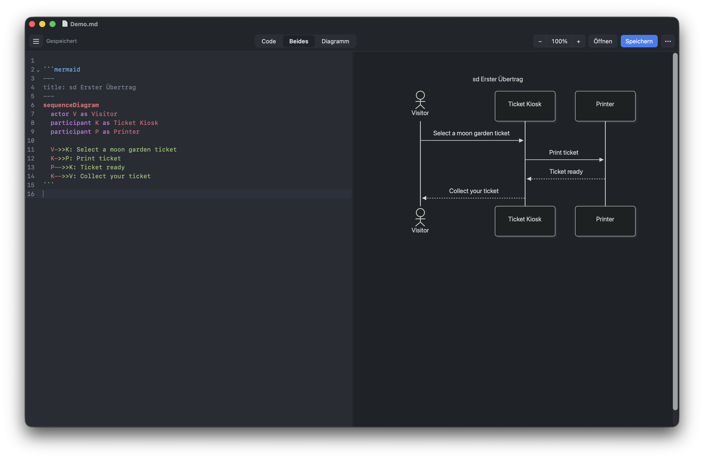

# Mermaid Editor

A small tool I built for fun to make writing Mermaid diagrams easier. Code on the left, live preview on the right. The upcoming release offers the UI in English and German. Maybe it’ll come in handy or spark an idea!

## Screenshots

